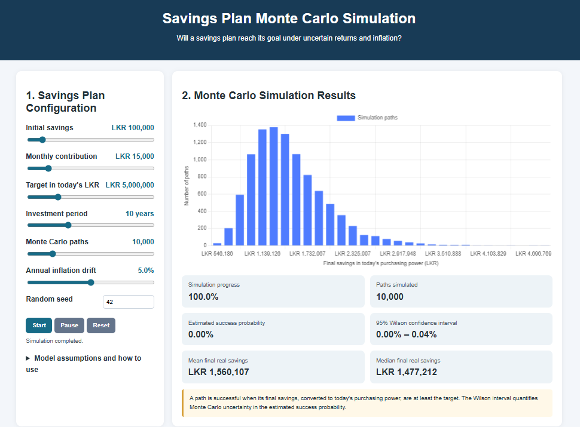
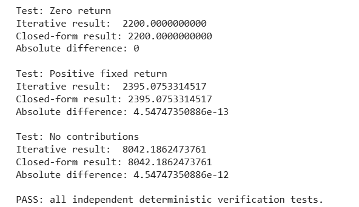

# SAVINGS PLAN MONTE CARLO SIMULATION

Will a Savings Plan Reach Its Goal Under Uncertain Returns and Inflation?

**Author:** W. Madara Chamudini

**[Live demo](https://wmadarachamudini.github.io/SAVINGS-PLAN-MONTE-CARLO-SIMULATION/)** · [](https://colab.research.google.com/drive/13dPAEUyJEXE4p4DHb6sErJdzP3dCgnYB?usp=sharing)



## The problem

Saving towards a large future expense involves uncertainty. Investment returns change over time, while inflation reduces the purchasing power of money. A savings plan that appears sufficient using a fixed return may therefore fail to reach its target in real terms.

This project investigates how monthly contributions, uncertain investment returns, inflation and changing market conditions affect the chance of reaching a savings target within a fixed period. The target is expressed in today's purchasing power, so the final nominal balance is adjusted for cumulative inflation before it is compared with the target.


## Quick start

**Notebook:** click the *Open in Colab* badge above, then *Runtime → Run all*. Everything installs and runs in about 1 minutes on a free runtime.

**Web demo:** open the [live demo](https://wmadarachamudini.github.io/SAVINGS-PLAN-MONTE-CARLO-SIMULATION/), or download this repository and double-click `docs/index.html`.

**Run locally (optional):**

```bash
pip install -r requirements.txt
jupyter notebook notebook/Savings Plan-MonteCarlo.ipynb
```

## Using the demo

In the first section, adjust the initial savings, monthly contribution, target, investment period, number of Monte Carlo paths, annual inflation drift and random seed, then use Start to run the simulation. The results section displays a histogram, estimated success probability, 95% Wilson confidence interval, mean and median final real savings. The sensitivity section compares different contribution and inflation values, while the market-regime section displays the assumed and observed regime transitions. 
<br><br> Full guide: [USER_GUIDE.md](USER_GUIDE.md).

## Model and mathematics

The model simulates savings monthly. Investment growth is applied first and the monthly contribution is added at the end of each month:

$
B_{t+1}=B_t(1+r_t)+C
$

Investment returns follow a Geometric Brownian Motion (GBM) process, with drift and volatility determined by a two-state Markov chain. Inflation is modelled as a separate stochastic process. The final nominal balance is converted into today's purchasing power by dividing it by cumulative inflation:

$
B_T^{real}=\frac{B_T}{I_T}
$

A path is successful when its final real balance is at least the target. The simulation estimates the success probability from repeated paths and reports a 95% Wilson score interval. 

Full derivations, assumptions and parameters: [THEORY.md](THEORY.md).

## Verification

The implementation was checked using deterministic and probabilistic tests:

- With initial savings of LKR 1,000, a monthly contribution of LKR 100, zero return and 12 months, the expected and calculated final balance were both LKR 2,200.
- The iterative savings calculation was compared with an independent closed-form calculation for zero returns, positive fixed returns and zero contributions. The largest absolute difference was approximately $4.55\times10^{-12}$.
- The transition matrix was checked to ensure that its probabilities were non-negative and each row summed to one.
- Re-running the simulation with the same random seed reproduced the same final balances and regime histories.
- The theoretical stationary regime proportions (0.60, 0.40) were compared with simulated proportions of approximately (0.6023, 0.3977).
- The measured Monte Carlo error-scaling slope was -0.503, close to the theoretical -0.5 rate.

These checks support the correctness and reproducibility of the implementation under the tested conditions.




## Concepts applied

This project applies input modelling and random variate generation to produce monthly investment-return and inflation shocks. Monte Carlo simulation is used to estimate the probability of reaching the savings target and the distribution of final real savings. A two-state Discrete-Time Markov Chain (DTMC) models persistence and transitions between Low-return and High-return market regimes. Statistical output analysis uses a 95% Wilson score interval to quantify Monte Carlo uncertainty. Deterministic calculations, closed-form comparisons and reproducibility checks are used for verification.


## Results

For the baseline settings (LKR 100,000 initial savings, LKR 15,000 monthly contribution, LKR 5,000,000 real target, 10 years, 10,000 paths and 5% annual inflation drift), the recorded Python notebook run produced:

| Measure | Result |
|---|---:|
| Successful paths | 1 out of 10,000 |
| Estimated success probability | 0.01% |
| 95% Wilson confidence interval | 0.00%–0.06% |
| Mean final real savings | LKR 1,558,454 |
| Median final real savings | LKR 1,472,580 |

The browser demo's recorded baseline run produced 0 successful paths out of 10,000 (0.00%; 95% Wilson interval: 0.00% - 0.04%). The Python and JavaScript implementations use separate seeded random-number generators, so their individual paths and exact estimates are not expected to be identical. Both runs indicate that the baseline contribution is insufficient to reach the target in almost all simulated paths.

The sensitivity analysis shows that increasing the monthly contribution improves the probability of reaching the target, while higher inflation reduces it. For example, in the notebook experiment at 5% annual inflation, the estimated success probability increased from 0.01% with a LKR 15,000 monthly contribution to 88.49% with a LKR 75,000 monthly contribution. These results depend on the illustrative assumptions used in the model.

## Limitations and future work

- The investment drift, volatility, inflation and Markov transition probabilities are illustrative assumptions rather than values calibrated to historical data. GBM and a two-state Markov chain also simplify real market behaviour and do not capture every feature, such as jumps, heavy tails or changing volatility.
- Investment-return and inflation shocks are assumed independent. Contributions are fixed and made at month-end; taxes, fees, withdrawals, missed contributions and changes in income are not included.
- Future work could calibrate the model using suitable historical data, explore alternative return and inflation models, and include changing contributions, fees and withdrawals.

This is an educational simulation for scenario analysis, not financial advice or a prediction of actual investment performance.


## Key references

1. N. Metropolis and S. Ulam, “The Monte Carlo method,” *Journal of the American Statistical Association*, vol. 44, no. 247, pp. 335–341, 1949. [https://doi.org/10.1080/01621459.1949.10483310](https://doi.org/10.1080/01621459.1949.10483310)
2. P. Glasserman, *Monte Carlo Methods in Financial Engineering*. New York, NY, USA: Springer, 2003.
3. S. E. Shreve, *Stochastic Calculus for Finance II: Continuous-Time Models*. New York, NY, USA: Springer, 2004.
4. J. R. Norris, *Markov Chains*. Cambridge, U.K.: Cambridge University Press, 1997.
5. E. B. Wilson, “Probable inference, the law of succession, and statistical inference,” *Journal of the American Statistical Association*, vol. 22, no. 158, pp. 209–212, 1927. [https://doi.org/10.1080/01621459.1927.10502953](https://doi.org/10.1080/01621459.1927.10502953)
6. A. M. Law, *Simulation Modeling and Analysis*, 5th ed. New York, NY, USA: McGraw-Hill Education, 2015.
7. C. R. Harris et al., “Array programming with NumPy,” *Nature*, vol. 585, pp. 357–362, 2020. [https://doi.org/10.1038/s41586-020-2649-2](https://doi.org/10.1038/s41586-020-2649-2)


Full list: [REFERENCES.md](REFERENCES.md).

## AI assistance

Developed with the help of AI coding and writing assistants. All code was reviewed, run and verified by the author.

## Licence and credits

Code: [MIT](LICENSE). The web demo uses [Chart.js](https://www.chartjs.org/) for charts, loaded from its CDN. The notebook uses Python libraries including NumPy and Matplotlib.
