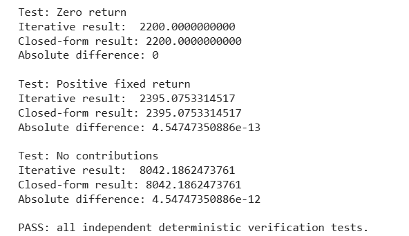

# Theory and mathematics

## 1. Problem formulation

This project models a monthly savings plan under uncertain investment returns and inflation. The aim is to estimate the probability of reaching a target of LKR 5,000,000 in today's purchasing power within 10 years.

The model uses Monte Carlo simulation to generate 10,000 possible savings paths. Investment returns are modelled using Geometric Brownian Motion (GBM), with two market regimes (Low-return and High-return) controlled by a Discrete-Time Markov Chain (DTMC). Inflation is modelled as a separate stochastic process.

The main quantities of interest are the probability of reaching the target, the distribution of final real savings, mean and median final savings, and the 95% Wilson confidence interval.

## 2. Assumptions

1. **Fixed monthly contributions:** A constant monthly contribution of LKR 15,000 is made at the end of each month.
2. **Initial savings:** Every simulation starts with LKR 100,000.
3. **Investment returns:** Returns follow a GBM process with drift and volatility depending on the current market regime.
4. **Two market regimes:** The market has Low-return and High-return states, with transitions determined by a fixed Markov transition matrix.
5. **Initial market state:** Every simulation path starts in the Low-return regime.
6. **Inflation:** Inflation follows a separate GBM-style stochastic process with an annual drift of 5% and volatility of 2%.
7. **Independent shocks:** Investment-return and inflation random shocks are assumed to be independent.
8. **Monthly update order:** Investment growth is applied first, followed by the monthly contribution.
9. **Fixed investment period:** The simulation runs for 10 years (120 months).
10. **Illustrative parameters:** The selected investment and inflation assumptions are hypothetical and are not forecasts of actual market performance.

## 3. Model equations

### 3.1 Monthly savings update

The nominal savings balance is updated monthly:

$$
B_{t+1}=B_t(1+r_t)+C
$$

Where:
- $B_t$ = nominal savings balance at the beginning of month $t$ (LKR).
- $r_t$ = monthly investment return (dimensionless).
- $C$ = fixed monthly contribution (LKR).

### 3.2 Investment-return process

Investment returns follow Geometric Brownian Motion:

$$
\frac{dS}{S}=\mu_jdt+\sigma_jdW
$$

The monthly GBM log increment is:

$$
X_t^r=
\left(\mu_j-\frac{\sigma_j^2}{2}\right)\Delta t
+\sigma_j\sqrt{\Delta t}Z_t
$$

The monthly simple return is:

$$
r_t=e^{X_t^r}-1
$$

Where:
- $\mu_j$ = annual investment drift for regime $j$.
- $\sigma_j$ = annual investment volatility for regime $j$.
- $\Delta t=1/12$ = monthly time step (years).
- $Z_t$ = standard normal random variable.
- $W$ = standard Wiener process.

### 3.3 Markov market regimes

The transition matrix is:

$$
P=
\begin{bmatrix}
0.90 & 0.10\\
0.15 & 0.85
\end{bmatrix}
$$

The rows represent the current regime and the columns represent the next regime. The model uses the following states:

- State 0: Low-return
- State 1: High-return

The stationary distribution is:

$$
\pi=(0.60,\ 0.40)
$$

### 3.4 Inflation process

The monthly inflation log increment is:

$$
X_t^\pi=
\left(\mu_\pi-\frac{\sigma_\pi^2}{2}\right)\Delta t
+\sigma_\pi\sqrt{\Delta t}Y_t
$$

The monthly inflation rate is:

$$
\pi_t=e^{X_t^\pi}-1
$$

Where:
- $\mu_\pi$ = annual inflation drift.
- $\sigma_\pi$ = annual inflation volatility.
- $Y_t$ = standard normal random variable independent of $Z_t$.

Cumulative inflation is:

$$
I_T=\prod_{t=1}^{T}(1+\pi_t)
$$

The final real savings balance is:

$$
B_T^{real}=\frac{B_T}{I_T}
$$

A path is successful when:

$$
B_T^{real}\geq G
$$

Where $G$ is the target of LKR 5,000,000 in today's purchasing power.

### 3.5 Success probability and confidence interval

The estimated success probability is:

$$
\hat p=\frac{K}{N}
$$

Where:
- $K$ = number of successful simulation paths.
- $N$ = total number of simulation paths.

A 95% Wilson score interval is used to measure Monte Carlo sampling uncertainty.

### Model parameters

| Symbol | Meaning | Units | Value / range | Source |
|---|---|---|---|---|
| $B_0$ | Initial savings | LKR | 100,000 | Project assumption |
| $C$ | Monthly contribution | LKR/month | 15,000 | Project assumption |
| $G$ | Real savings target | LKR | 5,000,000 | Project assumption |
| $Y$ | Investment period | Years | 10 | Project assumption |
| $T$ | Number of monthly steps | Months | 120 | Calculated |
| $N$ | Simulation paths | Paths | 10,000 | Project setting |
| $\mu_0$ | Low-return drift | Annual rate | 3% | Project assumption |
| $\sigma_0$ | Low-return volatility | Annual rate | 12% | Project assumption |
| $\mu_1$ | High-return drift | Annual rate | 9% | Project assumption |
| $\sigma_1$ | High-return volatility | Annual rate | 18% | Project assumption |
| $\mu_\pi$ | Inflation drift | Annual rate | 5% | Project assumption |
| $\sigma_\pi$ | Inflation volatility | Annual rate | 2% | Project assumption |
| $P$ | Markov transition matrix | Probabilities | [[0.90, 0.10], [0.15, 0.85]] | Project assumption |
| $\Delta t$ | Monthly time step | Years | 1/12 | Calculated |
| Seed | Random seed | Integer | 42 | Project setting |

## 4. Numerical method

The project uses monthly Monte Carlo simulation with 10,000 independent paths over 120 monthly steps.

For each path:

1. Initialise savings to LKR 100,000 and the market regime to Low-return.
2. Generate the next market regime using the Markov transition matrix.
3. Select the corresponding investment drift and volatility.
4. Generate a standard normal random variable and calculate the monthly GBM investment return.
5. Apply investment growth to the current savings balance.
6. Add the fixed monthly contribution at the end of the month.
7. Generate the monthly inflation rate and update cumulative inflation.
8. Repeat for 120 months.
9. Convert the final nominal balance into real savings using cumulative inflation.
10. Check whether the final real savings reach the target.

The simulation uses the exact GBM monthly log increment rather than an explicit Euler approximation for the multiplicative investment and inflation processes. A fixed monthly time step of 1/12 year is used.

The number of paths controls the statistical precision of the estimated success probability. Monte Carlo standard error decreases approximately at a rate proportional to $1/\sqrt{N}$. A fixed random seed of 42 is used to support reproducibility.

## 5. Verification

The implementation was checked using deterministic calculations, mathematical comparisons and probabilistic tests.

| Check | Expected | Obtained | Pass? |
|---|---|---|---|
| Zero-return test | LKR 2,200 | LKR 2,200 (difference: 0) | Yes |
| Positive fixed-return test | Iterative and closed-form results should match | Difference: $4.55\times10^{-13}$ | Yes |
| No-contribution test | Iterative and closed-form results should match | Difference: $4.55\times10^{-12}$ | Yes |
| Transition matrix | Non-negative probabilities; each row sums to 1 | All conditions satisfied | Yes |
| Reproducibility | Same seed produces identical results | Identical balances and regime histories | Yes |
| Stationary distribution | Theoretical proportions (0.60, 0.40) | Simulated proportions (0.6023, 0.3977) | Yes |
| Monte Carlo error scaling | Slope approximately -0.5 | Measured slope: -0.503 | Yes |

All independent deterministic verification tests passed. The structural and probabilistic checks also passed under the tested conditions.

## 6. Concepts applied

| Concept | Where it is used in this project |
|---|---|
| Input modelling and random variate generation | Standard normal random variables generate monthly investment-return and inflation shocks. |
| Monte Carlo simulation | Repeated simulation paths estimate the probability of reaching the savings target and the distribution of final real savings. |
| Discrete-Time Markov Chains (DTMC) | Models transitions and persistence between Low-return and High-return market regimes. |
| Geometric Brownian Motion (GBM) | Generates stochastic investment returns and inflation rates. |
| Monte Carlo confidence intervals | The 95% Wilson score interval measures uncertainty in the estimated success probability. |
| Sensitivity analysis | Examines how different monthly contributions and inflation rates affect the probability of reaching the target. |
| Verification and validation | Deterministic tests, closed-form comparisons, transition checks and reproducibility tests check the implementation. |

## 7. References

See [REFERENCES.md](REFERENCES.md).