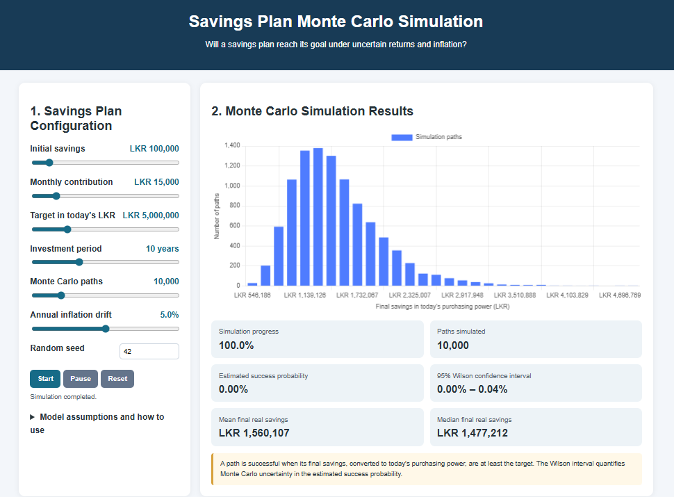

# User guide: Savings Plan Monte Carlo Simulation web demo

**Open the demo:** [https://wmadarachamudini.github.io/SAVINGS-PLAN-MONTE-CARLO-SIMULATION/](https://wmadarachamudini.github.io/SAVINGS-PLAN-MONTE-CARLO-SIMULATION/). It runs in your browser using Chrome, Edge or Firefox. Nothing needs to be installed. An internet connection is required to load Chart.js from its CDN.

## Controls

| Control | What it does                                                          | Range                               | Default                                |
|---|-----------------------------------------------------------------------|-------------------------------------|----------------------------------------|
| Initial savings | Sets the starting savings balance (LKR).                              | 0 - 1,000,000 (step 10,000)         | 100,000                                |
| Monthly contribution | Sets the amount deposited at the end of each month (LKR).             | 0 - 100,000 (step 5,000)            | 15,000                                 |
| Target in today's LKR | Sets the savings target in today's purchasing power (LKR).            | 500,000 - 20,000,000 (step 250,000) | 5,000,000                              |
| Investment period | Sets the simulation duration in years.                                | 1 - 30 years (step 1)               | 10 years                               |
| Monte Carlo paths | Sets the number of simulation paths.                                  | 1,000 - 50,000 (step 1,000)         | 10,000                                 |
| Annual inflation drift | Sets the assumed annual inflation rate.                               | 0 - 10% (step 0.5%)                 | 5%                                     |
| Random seed | Sets the seed used for reproducible random-number generation.         | 1 - 999,999,999                     | 42                                     |
| Start | Starts the Monte Carlo simulation.                                    | -                                   | -                                      |
| Pause / Resume | Pauses the current simulation or continues it.                        | -                                   | -                                      |
| Reset | Clears the current results and prepares the simulation for a new run. | -                                   | -                                      |
| Monthly contributions (Sensitivity Analysis) | Accepts 1 - 5 contribution values separated by commas (LKR).          | 0 - 10,000,000                      | 15,000, 25,000, 35,000, 50,000, 75,000 |
| Annual inflation rates (Sensitivity Analysis) | Accepts 1 - 5 inflation values separated by commas.                   | 0 - 20%                             | 2, 3.5, 5, 6.5                         |

## Reading the outputs

- **Histogram:** Shows the distribution of final real savings across the simulated paths. The horizontal axis represents final savings in today's purchasing power (LKR), and the vertical axis represents the number of simulation paths.
- **Quantitative output:** Displays simulation progress, completed paths, estimated success probability, 95% Wilson confidence interval, mean final real savings and median final real savings.
- **Sensitivity analysis:** Displays a comparison chart and results table for different contribution and inflation combinations. Each scenario uses 10,000 simulation paths and reports the success probability, 95% Wilson confidence interval and median real savings. The best-performing scenario is also highlighted.
- **Market regime statistics:** Displays the theoretical transition probabilities and observed Low-return and High-return regime frequencies and transitions from the latest main simulation.
- **Interpretation:** Provides a summary of the estimated probability of reaching the target and the final real-savings distribution.

## Try this

1. Keep the default settings and press Start. Observe the histogram, success probability and final real-savings statistics.
2. Increase the monthly contribution to LKR 50,000 and run the simulation again. Compare the success probability with the baseline result.
3. Change the annual inflation drift from 5% to 2% and observe how lower inflation affects the final real savings.
4. Open Sensitivity Analysis and compare different monthly contributions and inflation rates. Observe how the success probability changes across scenarios.

## Check against the notebook

With the default settings (LKR 100,000 initial savings, LKR 15,000 monthly contribution, LKR 5,000,000 target, 10 years, 10,000 paths, 5% annual inflation drift and random seed 42), the recorded web-demo run produced:

- Successful paths: 0 out of 10,000.
- Estimated success probability: 0.00%.
- 95% Wilson confidence interval: 0.00%–0.04%.
- Mean final real savings: LKR 1,560,107.
- Median final real savings: LKR 1,477,212.

The Python notebook baseline run produced 1 successful path out of 10,000, with a success probability of 0.01% and a 95% Wilson confidence interval of 0.00%–0.06%.

Exact path-by-path equality is not expected because the Python notebook and JavaScript demo use separate random-number generators. Therefore, their results should be compared based on their overall distributions and estimated probabilities.

## Limitations

- The web demo implements the main simulation, sensitivity analysis and market-regime statistics. The additional experiments and verification studies available in the Python notebook are not all included in the browser version.
- The model uses illustrative investment-return, inflation and Markov transition assumptions rather than calibrated historical data.
- Investment-return and inflation shocks are assumed to be independent.
- Taxes, fees, withdrawals, missed contributions and changes in monthly contributions are not included in the main simulation.
- Sensitivity analysis uses 10,000 paths per scenario, regardless of the main simulation path count.
- Results are estimates based on random simulation paths and should not be treated as guaranteed outcomes or financial advice.